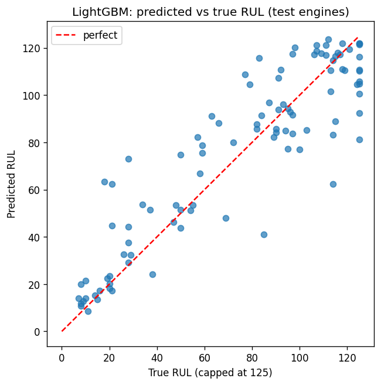

# Jet Engine Failure Prediction

Predicts how many flight cycles a turbofan engine has left before failure, using NASA's C-MAPSS sensor data. A LightGBM model cuts error by **56.7%** versus a naive baseline (test RMSE 18.6 vs 43.1 cycles) and flags **17 of the 25** engines that were truly within 30 cycles of failure, with only **1 false alarm**.



## Problem

Unplanned engine failures are expensive and dangerous, while replacing parts too early wastes money. If a model can estimate **remaining useful life (RUL)** from sensor readings, maintenance can be scheduled just in time.

## Data

NASA C-MAPSS turbofan degradation dataset, subset **FD001**: 100 training engines run to failure, and 100 test engines whose recordings stop before failure, with the true RUL provided separately.
Download `train_FD001.txt`, `test_FD001.txt` and `RUL_FD001.txt` from the [NASA Prognostics Data Repository](https://www.nasa.gov/intelligent-systems-division/discovery-and-systems-health/pcoe/pcoe-data-set-repository/) (or the Kaggle mirror) and place them in the project folder. The data is not included in this repo.

## Approach

1. **Target:** RUL = last cycle − current cycle, **capped at 125**, since early-life engines show no measurable degradation.
2. **Sensors:** dropped [N] near-constant sensors, kept [M].
3. **Features:** rolling mean and standard deviation (15-cycle window) per sensor, to capture trends rather than single noisy readings.
4. **Validation:** split **by engine** (not by row) so no engine appears in both train and validation; confirmed with 5-fold GroupKFold.
5. **Models:** mean baseline → linear regression → LightGBM (early stopping on validation).
6. **Test:** scored on the **last recorded cycle** of each of the 100 test engines against `RUL_FD001.txt`.

## Results

| Model | Validation RMSE | Test RMSE |
|---|---|---|
| Baseline (predict mean) | 41.72 | 43.07 |
| Linear regression | 17.66 | 21.69 |
| **LightGBM** | **15.32** | **18.64** |

Test RMSE is measured against the true RUL file (in cycles). Against the capped RUL (max 125) it is 41.94 / 20.62 / 17.46 respectively. LightGBM reduces error by 56.7% relative to the baseline.

**Maintenance alert** (flag an engine when predicted RUL < 30 cycles):

| Truly at risk (RUL < 30) | Caught | Missed | False alarms | Recall | Precision |
|---|---|---|---|---|---|
| 25 | 17 | 8 | 1 | 68% | 94.4% |

**Threshold trade-off:**

| Alert if predicted RUL < | Caught (of 25) | False alarms |
|---|---|---|
| 20 | 12 | 0 |
| 30 | 17 | 1 |
| 40 | 20 | 1 |
| 50 | 22 | 5 |

Raising the threshold from 30 to 40 cycles catches 3 more at-risk engines (80% recall) with no extra false alarms. Going to 50 catches 22 of 25 but raises false alarms from 1 to 5. Since a missed failure is usually far costlier than an unnecessary inspection, a threshold of 40 to 50 would likely be preferable in practice, depending on inspection cost.

## Limitations

- Trained and tested on a single simulated dataset (FD001: one operating condition, one fault mode). Results may not carry over to real engines or to the harder FD002–FD004 subsets.
- The RUL cap of 125 is a modelling choice; predictions are not meaningful beyond it.
- Only 100 test engines (25 at risk), so metrics such as recall have considerable uncertainty; the alert threshold was compared on the same test set and should be confirmed on fresh data.
- Not a certified maintenance tool. This is a learning project.

## How to run

```bash
git clone [your-repo-url]
cd [your-repo-folder]
pip install -r requirements.txt
python jet_engine_rul.py
```

This prints validation and test metrics and writes `results.json`, `sensors_over_time.png` and `pred_vs_true.png`.

## Tech

Python, pandas, scikit-learn, LightGBM, matplotlib.
